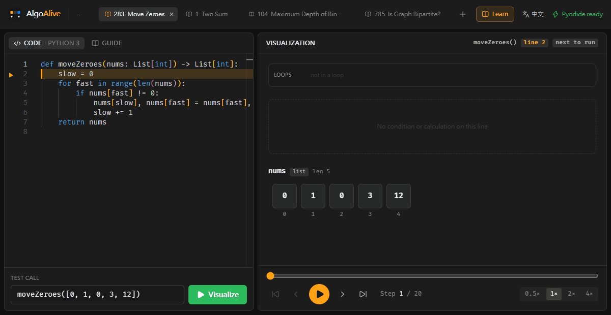
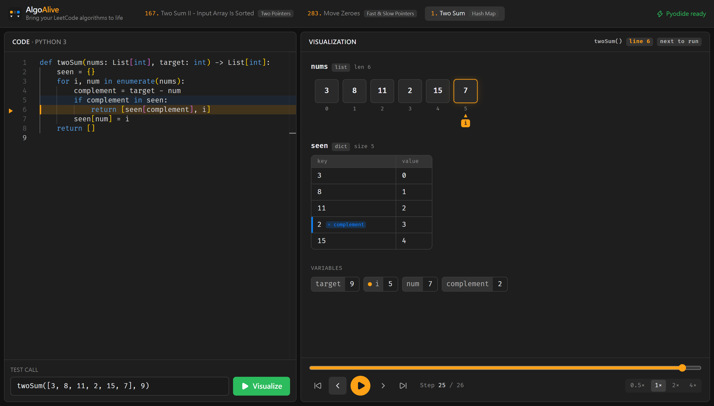

# AlgoAlive

> *Bring your LeetCode algorithms to life*

**🔗 線上 Demo：https://power28.github.io/AlgoAlive/**

[](https://power28.github.io/AlgoAlive/)

AlgoAlive 是專為 **Python LeetCode 刷題** 設計的互動式步驟動畫器。貼上一般的 Python 函式與測試呼叫，按下 **Visualize**，就能一步步看到 list 方格、指針移動、dict 查表與變數變化——不用手動加任何 `print`。

全部在瀏覽器內執行（Pyodide / WebAssembly），純靜態網頁即可部署，不需後端。

## 功能



- **零侵入追蹤**：以 `sys.settrace` 攔截使用者函式的 `line` / `return` / `exception` 事件，自動快照 `frame.f_locals`
- **List 方格 + 指針**：`left` / `right` / `i` / `j` / `slow` / `fast` / `lo` / `hi` / `mid`… 等索引變數自動畫成格子下方的彩色指針；`left`+`right` 等配對會畫出視窗範圍
- **絲滑交換動畫**：前端追蹤每個格子的「身分」，swap / sort 時格子會真的移動（framer-motion `layout`）
- **Dict 查表**：新增 key 綠色、值變動橘色；若某個區域變數的值正好是 dict 的 key（例如 `complement`），該列會被標示
- **Set、純量變數、`print` 輸出、回傳值、例外** 皆有對應顯示
- **播放控制**：上一步 / 下一步 / 播放暫停 / 時間軸拖曳 / 0.5×–4× 速度；鍵盤 `←` `→` `Space` `Home` `End`
- **Monaco 編輯器**：橘色高亮「即將執行」的行，藍色淡化標示上一步的行；`Ctrl+Enter` 執行
- **防呆**：超過 500 步拋出 `TimeoutError`（仍可回放已記錄的步驟）；單次執行超過 10 秒會直接重啟 Worker

## 快速開始

```bash
npm install
npm run dev
```

```bash
npm run build   # 輸出至 dist/，可直接部署到 GitHub Pages / Netlify / Vercel
```

push 到 `main` 時會由 [GitHub Actions](.github/workflows/deploy.yml) 自動建置並部署到 GitHub Pages。

## 架構

```
src/
├─ runtime/
│  ├─ tracer.py            # sys.settrace 追蹤器 + 帶型別標籤的序列化
│  ├─ pyodide.worker.ts    # Web Worker：載入 Pyodide (CDN v0.26.2) 並執行 tracer
│  └─ runner.ts            # 主執行緒端：Worker 生命週期、逾時重啟、狀態通知
├─ lib/
│  ├─ pyValue.ts           # Python repr 格式化、型別判斷
│  ├─ cellKeys.ts          # 跨步驟追蹤 list 格子身分（讓 swap 變成移動動畫）
│  └─ pointers.ts          # 指針變數偵測與配色
├─ components/             # CodeEditor / ArrayView / CollectionViews / Visualizer / Controls
├─ hooks/usePlayback.ts    # 播放狀態
└─ examples.ts             # 內建範例：167、283、1
```

### 執行流程

1. 使用者程式碼以 filename `<algoalive>` 編譯後 `exec` 進一個新的 namespace（已預先 `from typing import *`、`from collections import *` 等，與 LeetCode 環境相近）
2. 測試呼叫（例如 `twoSum([2, 7, 11, 15], 9)`）以 `<input>` 編譯，開啟 `sys.settrace` 後執行
3. tracer 只記錄 `co_filename == "<algoalive>"` 的 frame，回傳 JSON：

```ts
interface ExecutionStep {
  stepIndex: number;
  lineNumber: number;                   // line 事件 = 「即將執行」這一行
  variables: Record<string, PyValue>;   // 帶型別標籤，例如 { type: 'list', items: [...] }
  event: 'line' | 'return' | 'exception';
  returnValue?: PyValue;
  exception?: string;
  funcName: string;
  depth: number;                        // 遞迴深度
  stdout: string;                       // 累積的 print 輸出
}
```

`variables` 採用帶型別標籤的 `PyValue`（而非裸 JSON），以區分 `list` / `tuple` / `set`、保留 dict 的非字串 key，並安全表示 `inf`、大整數等 JSON 無法直接表達的值。

### LeetCode `class Solution` 寫法

也可以直接貼 `class Solution:` 的寫法，測試呼叫改成 `Solution().twoSum([2, 7, 11, 15], 9)` 即可（`self` 會自動隱藏）。

## License

[MIT](LICENSE)
