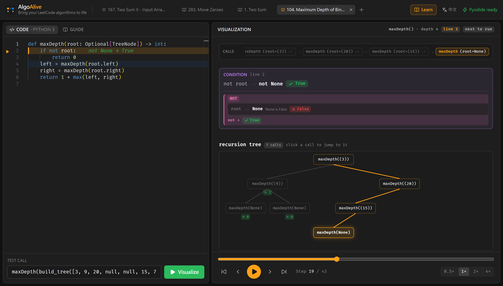
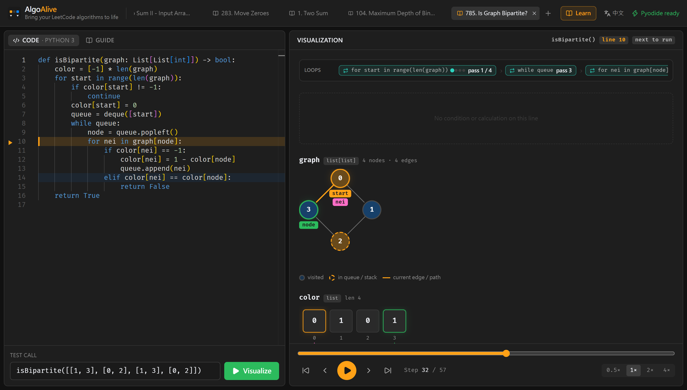
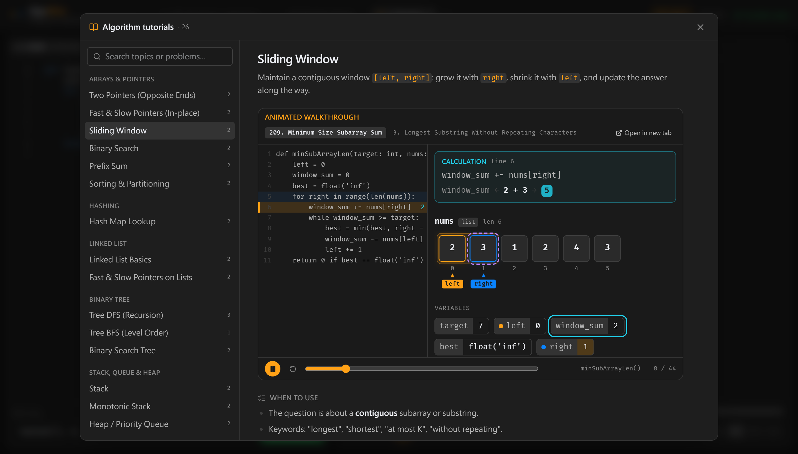

# AlgoAlive

> *Bring your LeetCode algorithms to life*

**🔗 線上 Demo：https://power28.github.io/AlgoAlive/**

[](https://power28.github.io/AlgoAlive/)

AlgoAlive 是專為 **Python LeetCode 刷題** 設計的互動式步驟動畫器。貼上一般的 Python 函式與測試呼叫，按下 **Visualize**，就能一步步看到 list 方格、指針移動、dict 查表與變數變化——不用手動加任何 `print`。

全部在瀏覽器內執行（Pyodide / WebAssembly），純靜態網頁即可部署，不需後端。

## 功能


- **零侵入追蹤**：以 `sys.settrace` 攔截使用者函式的 `line` / `return` / `exception` 事件，自動快照 `frame.f_locals`
- **List / 字串方格 + 指針**：分析程式碼中的 `nums[i]`、`text1[i - 1]` 等索引寫法，把對應變數畫成格子下方的彩色指針（固定帶位移時標成 `i-1`）；`left`+`right`、`lo`+`hi` 等配對會畫出視窗範圍；被當成陣列走訪的字串也會拆成字元格子
- **2D 格子**：`list[list]`（DP 表、網格 BFS、矩陣）畫成表格，並依 `grid[r][c]`、`dp[i][j]` 標出目前位置；旋轉、轉置、交換時格子會帶著值滑到新位置（例如 48. 旋轉圖像）
- **鏈結串列**：節點 → 箭頭 → 節點，`head` / `prev` / `curr` / `slow` / `fast` 等變數標在節點下方；反轉時節點會在兩條鏈之間平滑移動，剛改過的 `next` 以橘色箭頭標示，環以紅色 ↺ 標出接回位置
- **二元樹**：自動排版的樹狀圖，翻轉等修改會讓整棵子樹滑到新位置；遞迴時以虛線節點與橘色連線標出外層呼叫的路徑（例如 `root·2` 代表第 2 層呼叫的 `root`）
- **字典樹**：`children` 是「字元 → 節點」dict 的節點（例如內建的 `TrieNode`）畫成多叉樹，節點裡寫著走到它的字元，單字結尾（`is_end` / `is_word` 為真）畫成綠色雙圈，新建的節點會淡綠色閃一下
- **一般圖**：自訂節點（`Node.neighbors`）或名為 `graph` / `adj` 的鄰接串列（`dict` 或 `list[list]`，可帶權重 `(v, w)`）畫成節點連線圖；`node` / `nxt` 等變數標在節點上並高亮目前走的邊，`visited` 填色、`queue` / `stack` 中的節點虛線框、`path` 的邊高亮，`indegree` / `dist` 等每個節點一個值的陣列顯示成旁邊的小標籤，`color` 陣列直接替節點著色
- **絲滑交換動畫**：前端追蹤每個格子的「身分」，swap / sort 時格子會真的移動（framer-motion `layout`）
- **break / continue**：執行到 `break` / `continue` 時，卡片說明跳出（或跳過這一圈剩下的部分）的是哪一個迴圈、接著會執行第幾行；巢狀迴圈只標最內層，「迴圈」列對應的那一圈也加上紅色「跳出」/ 黃色「跳過」標籤
- **內建函式**：執行到含有 `sum` / `min` / `max` / `sorted` / `.sort()` / `reversed` / `any` / `all` / `enumerate` / `zip` / `set` / `Counter` / `"".join` 的那一行時，「內建函式」卡片以唯讀方式事先算出它怎麼處理每個元素：`sum` 逐一累加、`min` / `max` 逐一比較並以皇冠標出勝出者（支援 `key=`）、排序時格子先照原本順序排開再滑到排序後的位置、`any` / `all` 逐一標 ✓ / ✗ 並停在短路的位置、`zip` 把相同位置配成一組並標出被捨棄的多餘元素、`set` 劃掉重複值、`Counter` 列出次數；`any(x > 3 for x in nums)` 這類產生器運算式也會逐元素說明。迭代器只能走訪一次，用到迭代器的運算式不會預先求值；`and` / `or` 後面、三元運算式分支中的呼叫不一定會執行，也不預先說明
- **設計類題目**：測試呼叫貼上 LeetCode 的兩個陣列（`["MinStack", "push", …]`、`[[], [-2], …]`）即可執行；最上方的「操作順序」列出每個操作，目前這個亮起來、做完的標出輸出（`→ null`、`→ -3`），點任一操作跳到它開始的步驟；`self` 上的狀態以 `self.stack`、`self.cache` 等變數顯示，同樣有陣列、dict、鏈結串列的視覺化，`self.stack.append(x)` 也有容器操作卡片，`outbox.append(inbox.pop())` 會說明元素從哪個容器搬到哪個容器；最後一步回傳所有操作的輸出
- **try / except 流程**：例外發生時，「例外」卡片列出型別與訊息、由內往外經過的每個 try 依序比對 except（✓ / ✗）、要先經過的 finally，以及最後的去向：被第幾行的 except 接住、離開函式丟回呼叫者的哪一行，或沒人接住而中止；執行到 `except` 那一行時說明「ValueError 符合 except ValueError 嗎？」，編輯器行尾也標 ✓ / ✗；`try:`、`else`、`finally` 的第一行各自說明為什麼會走到這裡（finally 之後例外會不會繼續往外拋）
- **同時賦值 / 交換**：`a, b = b, a`、`nums[i], nums[j] = nums[j], nums[i]`、`prev, curr = curr, nxt` 等寫法顯示「① 先把右邊每一個值都算好 → ② 再同時寫到左邊」，左右互換時標示「交換」並說明為什麼不需要暫存變數；讀取與寫入的位置分別加框
- **推導式**：`[x * x for x in nums if x > 1]`（以及 set / dict 推導式）在迴圈列顯示第幾圈、在序列上標出迭代變數，「推導式」卡片顯示這一圈的元素、條件是否通過、算出的值，結果清單一格一格長出來
- **切片**：`s[i:j]`、`nums[:mid]`、`path[:]` 在原本的陣列 / 字串上框出被切出的範圍並標示結果（`s[left:right] → 'bcd'`），有間隔的切片（`[::2]`、`[::-1]`）個別標出被選到的格子
- **遞迴樹**：有遞迴（或多次呼叫輔助函式）時，把到目前為止的所有呼叫畫成一棵樹：目前這次呼叫亮框、還在堆疊上等待子呼叫的是虛線框（連線為橘色）、已回傳的標出回傳值（`→ 3`）；樹隨播放一個個長出來，位置依最終的樹先排好所以不會推擠；點任一節點跳到那次呼叫開始的步驟。對照有無記憶化時樹的大小特別清楚
- **容器操作**：`append` / `pop` / `popleft` / `appendleft` / `insert` / `remove` / `add` / `discard`、`heapq.heappush` / `heappop` / `heapify`、`d[k] = v` / `del d[k]` 執行前，「容器操作」卡片用一句話說明會做什麼（「從 stack 的尾端取出 5，寫入 x」「從 queue 的前端取出 1」），要取出的值以唯讀方式事先算出；陣列格子有進場 / 離場動畫，取出後其餘格子滑過去補位；對空容器 `pop` 會事先警告
- **堆積樹狀圖**：被 `heapq` 操作的 list 另外畫成完全二元樹（頂端標示「最小」），推入 / 取出後節點移動到新位置，看得出堆積如何重新排好
- **迴圈與函式呼叫**：視覺化最上方固定的兩列資訊——「迴圈」顯示目前是第幾圈（`for i in range(3, n + 1)` → 第 2 / 4 圈，附進度點；巢狀迴圈逐層顯示，最後一次檢查標示「結束」）；`for num in nums` 這種沒有索引的寫法會在 `nums` 上多一個 `num` 指針。「呼叫堆疊」由外而內列出每一層呼叫與參數（`maxDepth(root=(3)) › maxDepth(root=(9)) › …`），新呼叫滑入、回傳時顯示回傳值後收掉；只有多層呼叫（遞迴或輔助函式）時才會出現
- **條件判斷**：執行到 `if` / `while` / `return a < b` 等條件式時，程式碼行尾直接顯示代入數值後的結果（例如 `0 < 6 → True`），視覺化面板上方的「條件判斷」卡片逐項列出每個比較，`and` / `or` 被短路跳過的部分會標成灰色；被比較的格子、變數、節點加上紫色虛線框。含有可能修改資料的呼叫（例如 `stack.pop()`）的條件不會預先求值
- **邏輯運算**：`and` / `or` / `not` 畫成邏輯樹，依實際求值順序逐一亮起；被短路跳過的分支變暗並說明原因（「and 遇到 False 就停止」）；`[]`、`0`、`None` 這類非布林值會標註真假規則。在賦值 / 回傳中（例如 `tail.next = list1 or list2`），會顯示 `and` / `or` 實際回傳的運算元，而不只是 True / False
- **位元運算**：`result ^= num`、`n &= n - 1`、`n >> 1` 等運算在「計算」卡片下方以二進位逐位對齊，結果由右到左一位一位算出來；`~x` 也支援。有負數時改用 8 / 16 / 32 位的二補數（取放得下的最小位寬），最左邊以 `…1` / `…0` 標出 Python 整數向左無限延伸的符號位、負數的符號位加框，看得出 `x & 0xFFFFFFFF` 把 `…1` 截成 `…0`、`-6 >> 1` 左邊補 1；代入負數時自動加括號（`-(-6)`、`5 - (-3)`）
- **算術計算**：執行到 `mid = (lo + hi) // 2`、`dp[i] = dp[i - 1] + dp[i - 2]`、`left += 1`、`return 1 + max(left, right)` 等算式時，「計算」卡片把右邊一步步化簡（`(0 + 7) // 2 → 7 // 2 → 3`），程式碼行尾以青色顯示結果；被讀取的位置是紫色虛線框，即將寫入的目標（`mid`、`dp[i]`）是青色實線框。呼叫使用者自訂函式的算式不會預先求值
- **Dict 查表**：新增 key 綠色、值變動橘色；若某個區域變數的值正好是 dict 的 key（例如 `complement`），該列會被標示
- **Set、純量變數、`print` 輸出、回傳值、例外** 皆有對應顯示
- **播放控制**：上一步 / 下一步 / 播放暫停 / 時間軸拖曳 / 0.5×–4× 速度；鍵盤 `←` `→` `Space` `Home` `End`
- **Monaco 編輯器**：橘色高亮「即將執行」的行，藍色淡化標示上一步的行；`Ctrl+Enter` 執行
- **修改後標示舊的結果**：執行後再修改程式碼或測資，右邊會出現「程式碼已修改」/「測資已修改」的提示卡與「重新視覺化」按鈕，舊的動畫轉成半透明灰階、標題列標上「舊的結果」，左邊的「視覺化」按鈕外圈脈動；改回原樣（例如復原）時提示自動消失
- **自訂頁籤**：新增空白頁籤或從教學範例開啟、雙擊重新命名、關閉；程式碼與測資自動存在瀏覽器（localStorage），重新整理也不會消失
- **中英雙語**：右上角一鍵切換介面與教學內容語言（也可用 `?lang=zh` / `?lang=en`）
- **防呆**：超過 500 步拋出 `TimeoutError`（仍可回放已記錄的步驟）；單次執行超過 10 秒會直接重啟 Worker





## 演算法教學



點右上角 **Learn / 演算法教學** 開啟。每個主題最上方都有**動畫示範**：在背景實際執行範例，左邊程式碼標出執行中的行、右邊是同樣的陣列 / 指針 / 樹 / 圖動畫，自動循環播放（可暫停、拖曳時間軸、切換該主題的其他範例；捲出畫面時自動暫停，系統開啟「減少動態效果」時不自動播放）。

接著是「什麼時候用、核心觀念、程式模板、複雜度、常見陷阱」，並附 1～3 題可直接執行的 LeetCode 範例；從範例開啟的頁籤可以把左側切到「教學」，邊讀邊跑。

| 分類 | 主題（範例題號） |
|---|---|
| 陣列與指針 | 對撞雙指針（167、11）· 快慢指針（283、26）· 滑動視窗（209、3）· 二分搜尋（704、35）· 前綴和（1480、560）· 排序與分區（75、912）· 矩陣（48、74） |
| 雜湊 | 雜湊表查找（1、242） |
| 鏈結串列 | 鏈結串列基礎（206、21）· 快慢指針（876、141） |
| 樹 | 樹的 DFS（104、226、112）· 樹的 BFS（102）· 二元搜尋樹（700、98）· 字典樹（14、720） |
| 堆疊、佇列與堆積 | 堆疊（20、150）· 佇列與雙端佇列（1700、239）· 單調堆疊（739、496）· 堆積 / 優先佇列（215、347、1046） |
| 圖與網格 | 圖的走訪（133、797、785）· Dijkstra 最短路徑（743）· 網格 BFS（200）· 拓撲排序（207）· 並查集（547） |
| 動態規劃 | 一維 DP（70、198、322）· 二維 DP（62、1143） |
| 其他技巧 | 貪心法（121、55）· 遞迴與記憶化（509、1137）· 回溯法（78、46）· 區間問題（56）· 位元運算（136、191、371）· 例外處理（468、65）· 內建函式（49、896、1984）· 設計類題目（155、232、146） |


教學內容在 [src/tutorials/](src/tutorials/)，新增主題只要照 `Tutorial` 型別加一筆資料。

## 快速開始

```bash
npm install
npm run dev
```

```bash
npm run build   # 輸出至 dist/，可直接部署到 GitHub Pages / Netlify / Vercel
```

push 到 `main` 時會由 [GitHub Actions](.github/workflows/deploy.yml) 自動建置、**跑完測試**，通過後才部署到 GitHub Pages。
開 Pull Request 時，[test.yml](.github/workflows/test.yml) 會在 PR 上建置並跑同一套測試（不部署），合併前就能看到結果。

### 測試

```bash
npm run build   # e2e 測試的是 dist/，先建置
npm test        # = test:tracer + test:e2e
```

| 指令 | 內容 |
|---|---|
| `npm run test:tracer` | [scripts/check_examples.py](scripts/check_examples.py)：直接用 Python 執行所有教學範例，比對回傳值；另外測試 tracer 的步數上限、錯誤行號、`class Solution`、`print` 輸出、遞迴時的節點參照等行為。幾秒內完成，不需要瀏覽器 |
| `npm run test:e2e` | [scripts/e2e.mjs](scripts/e2e.mjs)：以 `vite preview` 啟動 `dist/`，用 headless Chrome 從教學庫逐一開啟範例、執行到最後一步，比對畫面上的回傳值；並測試頁籤（新增、重新命名、重新整理後保留、關閉）、語言切換，以及主控台沒有錯誤。加 `-- --url <網址>` 可以改測 dev server 或線上網站 |

每個範例的預期回傳值寫在 `src/tutorials/*.ts` 的 `expected` 欄位（與畫面上「returned」的寫法相同），兩種測試共用；新增範例時一併填上即可。

### 更新 README 截圖與 GIF

```bash
npm run capture                                  # 錄線上網站
npm run capture -- --url http://localhost:5173/  # 錄本機 dev server（先 npm run dev）
```

會重新產生 `docs/screenshot.png`（1. Two Sum）、`docs/tutorials.png`（教學頁）、`docs/tree.png`（二元樹遞迴）、`docs/graph.png`（一般圖）與 `docs/move-zeroes.gif`（283. Move Zeroes）。需要本機安裝 Chrome 或 Edge（找不到時設定 `CHROME_PATH`），以及含 [Pillow](https://pypi.org/project/pillow/) 的 Python 3。腳本在 [scripts/](scripts/)。

## 架構

```
src/
├─ runtime/
│  ├─ tracer.py            # sys.settrace 追蹤器 + 帶型別標籤的序列化
│  ├─ pyodide.worker.ts    # Web Worker：載入 Pyodide (CDN v0.26.2) 並執行 tracer
│  └─ runner.ts            # 主執行緒端：Worker 生命週期、逾時重啟、狀態通知
├─ lib/
│  ├─ pyValue.ts           # Python repr 格式化、型別判斷、2D 格子偵測
│  ├─ cellKeys.ts          # 跨步驟追蹤 list 格子身分（讓 swap 變成移動動畫）
│  ├─ indexing.ts          # 靜態分析 name[...] 索引寫法，決定指針屬於哪個容器
│  ├─ graph.ts             # 物件圖 / 鄰接串列 → 節點與邊，以及 visited、queue、path 等走訪狀態
│  └─ pointers.ts          # 指針變數偵測與配色
├─ tutorials/              # 雙語演算法教學與範例題（33 個主題、67 題）
├─ components/             # CodeEditor / ArrayView / GridView / StructureViews / GraphView / CollectionViews / Visualizer
│                          # Controls / TabBar / Library / TutorialView
├─ hooks/                  # usePlayback（播放）、useTabs（頁籤 + localStorage）
└─ i18n.tsx                # 中英雙語字串與語言切換
```

### 執行流程

1. 使用者程式碼以 filename `<algoalive>` 編譯後 `exec` 進一個新的 namespace（已預先 `from typing import *`、`from collections import *` 等，與 LeetCode 環境相近）
2. 測試呼叫（例如 `twoSum([2, 7, 11, 15], 9)`）以 `<input>` 編譯，開啟 `sys.settrace` 後執行
3. tracer 只記錄 `co_filename == "<algoalive>"` 的 frame，回傳 JSON：

```ts
interface ExecutionStep {
  stepIndex: number;
  lineNumber: number;                   // line 事件 = 「即將執行」這一行
  variables: Record<string, PyValue>;   // 帶型別標籤，例如 { type: 'list', items: [...] }
  event: 'line' | 'return' | 'exception';
  returnValue?: PyValue;
  exception?: string;
  funcName: string;
  depth: number;                        // 遞迴深度
  stdout: string;                       // 累積的 print 輸出
}
```

`variables` 採用帶型別標籤的 `PyValue`（而非裸 JSON），以區分 `list` / `tuple` / `set`、保留 dict 的非字串 key，並安全表示 `inf`、大整數等 JSON 無法直接表達的值。

### LeetCode `class Solution` 寫法

也可以直接貼 `class Solution:` 的寫法，測試呼叫改成 `Solution().twoSum([2, 7, 11, 15], 9)` 即可（`self` 會自動隱藏）。

### 設計類題目（MinStack、LRU Cache…）

把 LeetCode 的兩個陣列直接貼到測試呼叫即可（兩行、用逗號隔開，或貼進輸入框後換行被吃掉都可以）：

```
["MinStack", "push", "push", "getMin"]
[[], [-2], [-3], []]
```

AlgoAlive 會建立物件、依序呼叫每個方法，回傳每個操作的輸出（建構子為 `None`，與 LeetCode 的輸出格式相同）。

### 鏈結串列與二元樹的測資

執行環境已內建 LeetCode 的 `ListNode`、`TreeNode`、`Node`（圖）、`TrieNode`（字典樹：`children` dict 與 `is_end`），以及建立測資的輔助函式；`null` / `true` / `false` 也可以直接使用，LeetCode 的測資能原樣貼上：

```python
reverseList(build_list([1, 2, 3, 4, 5]))
hasCycle(build_list([3, 2, 0, -4], pos=1))      # 尾端接回第 1 個節點
maxDepth(build_tree([3, 9, 20, null, null, 15, 7]))
cloneGraph(build_graph([[2, 4], [1, 3], [2, 4], [1, 3]]))   # 1-indexed 鄰接串列
```

tracer 會把自訂類別的實例序列化成帶穩定 id 的參照（`{type: 'ref', id}`），每一步附上可達物件的 `heap`，以及外層呼叫中指向節點的變數（`stackRefs`），前端據此畫出串列與樹。

## License

[MIT](LICENSE)
